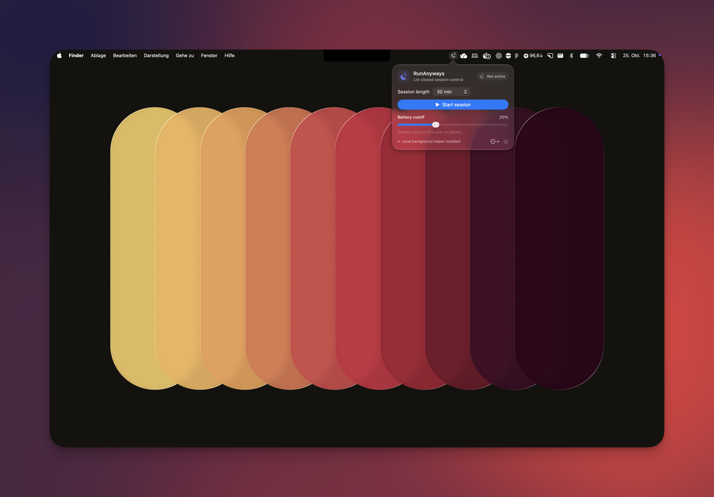
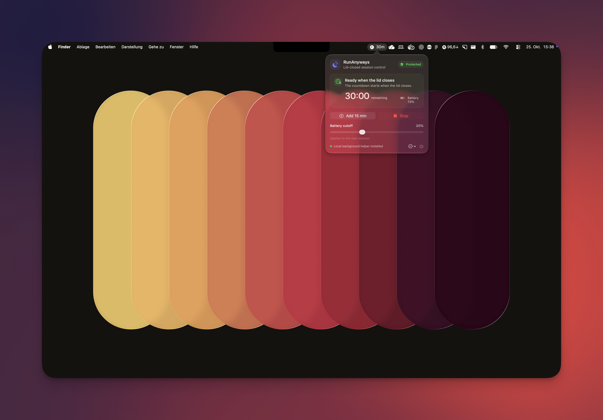

# RunAnyways

Keep the work running. Close the lid.

RunAnyways is a native macOS menu bar app for long-running background jobs,
including Codex and Claude Code. It keeps your Mac awake while its lid is closed.

<p></p>

<p></p>

## Features

- Choose a timer, set a custom duration, or run an unlimited session.
- Countdown runs only while the lid is closed; opening the lid pauses it.
- Works on battery or AC without an external monitor.
- Set a battery cutoff; serious or critical thermal pressure ends the session.

Closed-lid behavior varies by Mac and macOS version; see [testing notes](TESTING.md).

## Build and install

Requires macOS 13+, Intel or Apple Silicon, and Swift 5.9+ from Xcode Command
Line Tools.

```sh
./scripts/build-app.sh
./scripts/install-local.sh
open /Applications/RunAnyways.app
```

The administrator-authorized background helper is required for lid-close
sessions. Before updating, stop the session, disable the helper in RunAnyways,
quit the app, then install the updated build.

The system-wide sleep override remains active while a session is armed or
paused. Stop the session before packing your Mac.

## More

[Testing](TESTING.md) · [Architecture](ARCHITECTURE.md) ·
[Contributing](CONTRIBUTING.md) · [MIT License](LICENSE)
